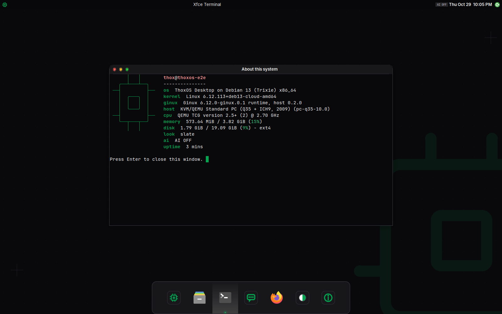

# ThoxInux

[](LICENSE)
[](https://thox.ai)
[](docs/QUICKSTART.md)

ThoxInux is THOX's open-source kernel and operating system core: a hardened fork of Ginux, Gregory Kurtzer's independent Rust-first x86-64 kernel that implements the Linux ABI as a personality and boots as a single EFI image directly through UEFI, with no host kernel underneath. ThoxInux adds the ThoxOS userspace, an agent supervisor with signed identity and capability enforcement, and the boot and installer tooling for local-first AI devices. ThoxOS Core is open. MeshStack and ThoxKey firmware are not.

**Your AI. Your Data. Your Rules.™**

## Preview



*Real capture, ginux-edition payload: ThoxOS Desktop on Debian 13 in QEMU, reached over RDP. This is not a bare-metal capture and not the unified ThoxInux EFI; see docs/RECONCILIATION-2026-10-31.md for payload identities and the evidence map in docs/continuation/ for what each capture proves.*

## Quick start

Tested on KnightHub (WSL2, Ubuntu, x86-64) on 2026-10-31. Full detail in docs/QUICKSTART.md.

Build the unified ThoxInux EFI from the pinned upstream source:

```bash
cd kernel/ginux
scripts/build-native.sh
```

Boot it in QEMU with the load-bearing configuration (2 GiB RAM, 1 vCPU, IOMMU flags are required, not optional):

```bash
scripts/run-vm.sh
```

Run the interactive userspace demo (Docker path, from the ginux-edition tree):

```bash
cd userspace/ginux-edition
make test
make demo-image
make selftest
make demo-shell
```

## Repository layout

| Path | What lives there |
|---|---|
| `kernel/` | The Ginux fork profile: unified THOX patch series (`kernel/ginux/patches/`), verified source preparation, native EFI build, launcher, kernel tests, recorded baseline artifacts |
| `boot/` | External SSD installer (`boot/ssd/`), boot profiles, KnightHub hardware profile |
| `userspace/` | ThoxOS userspace: ginux-edition desktop, shell, runtime and installer (`userspace/ginux-edition/`), and the agent supervisor workspace (`userspace/agentos/`) |
| `thoxbeam/` | ThoxBeam runtime **interface** only. The proprietary driver logic is not in this repository |
| `sdk/` | Toolchain pins and build documentation |
| `docs/` | User guide, quick start, development docs, compatibility matrix, threat model, reconciliation records, deployment guides |
| `evidence/` | Preserved validation evidence from the predecessor thoxos-ginux lanes, each item labelled with its payload |

## Documentation map

- User guide: docs/USER_GUIDE.md
- Quick start: docs/QUICKSTART.md
- Development: docs/DEVELOPMENT.md
- Syscall compatibility: docs/COMPATIBILITY.md
- Threat model: docs/THREAT-MODEL.md
- Upstream pin and fork discipline: UPSTREAM.md
- Rights and license ledger: RIGHTS.md
- Patch-set reconciliation: docs/RECONCILIATION-2026-10-31.md
- Agent handoff: .agents/HANDOFF.md

## Releases

Releases live on the Releases page of this repository. Only released versions get tags and release entries. The v0.9.0 release is staged as a draft while the repository is private and is published only on an explicit founder order.

## Agent handoff

Agents resuming this work start at .agents/HANDOFF.md.

## Governance

This repository is private during staging. Public publishing (social posts, website changes, store listings, public repository flips, registries, campaigns) requires Craig Ross's explicit approval via craig@thox.ai, CC tommy@thox.ai. The thox.ai website additionally requires Craig's request. See the governance note in docs/DEVELOPMENT.md.

## License

Apache-2.0. See LICENSE and NOTICE.md. Ginux upstream is Apache-2.0 (gmkurtzer/ginux); upstream copyright and notices are preserved throughout. MeshStack, ThoxKey firmware and ThoxWork are proprietary THOX technologies and are not licensed by anything in this repository.
