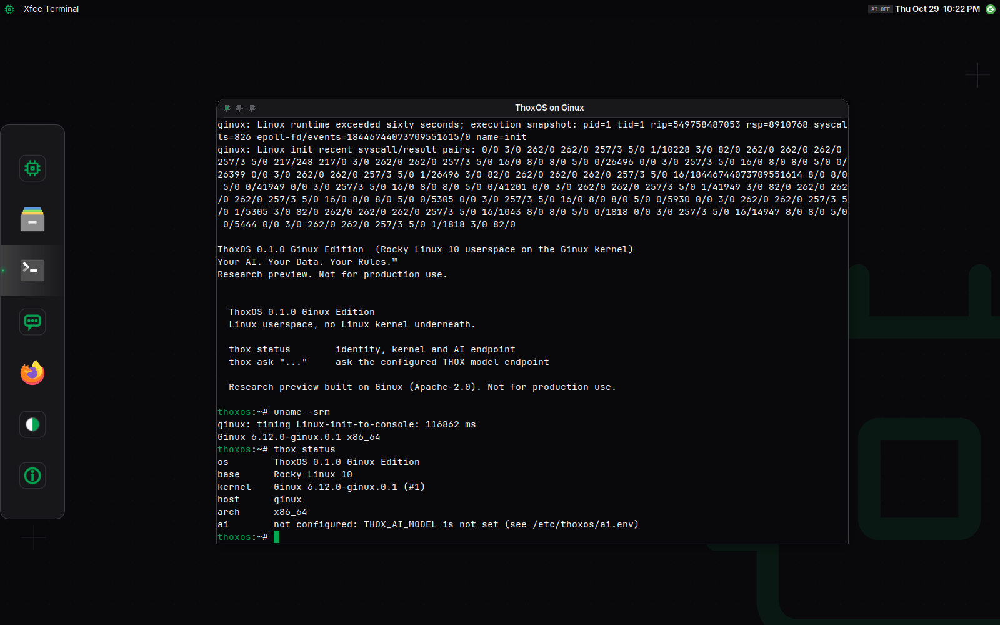

# ThoxOS Ginux Edition

[](LICENSE)
[](https://github.com/ttracx/thoxos-ginux/commits/ginux-edition-0.2.0)
[](https://thox.ai)
[](https://github.com/ttracx/thoxos-ginux/actions/workflows/ginux-edition-ci.yml)
[](docs/REVIEW.md)

ThoxOS userspace on the Ginux kernel: Linux programs, no Linux kernel underneath. Ginux is Gregory Kurtzer's independent Rust kernel, built with an AI coding agent in 11 days. This edition patches it for portable QEMU hosts and a private, offline image source, gives it a ThoxOS identity (os-release, banner, `thox` CLI with `thox ask`), and ships it four ways: a Docker demo that runs anywhere, an external-SSD image that boots KnightHub, and two Azure images (ThoxOS Desktop over RDP, or headless) that run Ginux under nested KVM.

Host images are version 0.2.0; the Ginux guest (kernel from the same pinned source and patches, ThoxOS userspace) is 0.1.0.

Your AI. Your Data. Your Rules.™




The Azure screenshots are real captures of the built VHD booted in QEMU (software emulation) and reached over RDP; the image has not run on Azure yet. More in [docs/previews/azure/](docs/previews/azure/) and the 0.1.0 web console in [docs/previews/](docs/previews/).

## Quick start

```bash
EXTRA_CA=/path/to/proxy-ca.pem make demo-image   # EXTRA_CA only behind a TLS-inspecting proxy
make selftest                                     # headless boot gate: welcome + login prompt
make demo-shell                                   # ThoxOS shell on the Ginux kernel (Ctrl-A then X quits)
```

Azure (ThoxOS Desktop image, then publish and deploy):

```bash
bash installer/build-host-image.sh --target azure --desktop desktop \
    --demo-image thoxos-g/demo:0.1.0 --host-image thoxos-g/azure-desktop-host:0.2.0 --size 8G --out build/azure
bash tests/e2e/boot-azure-image.sh build/azure/thoxos-ginux-azure-desktop-0.2.0.vhd build/e2e-azure 600
azure/publish-image.sh --vhd build/azure/thoxos-ginux-azure-desktop-0.2.0.vhd --resource-group thoxos-images --location eastus
az deployment group create --resource-group thoxos-demo --template-file azure/azuredeploy.json \
    --parameters imageVersionId=... allowedSourceCidr=YOUR.IP/32 adminPasswordOrKey=...
```

The first two commands ran for this version; publishing and deploying have not run against an Azure subscription. KnightHub external SSD and every other workflow: [docs/QUICKSTART.md](docs/QUICKSTART.md), [docs/AZURE.md](docs/AZURE.md).

## Repository layout

| Path | Contents |
|---|---|
| `patches/` | ThoxOS changes to upstream Ginux (QEMU portability, banner, scoped registry root) |
| `scripts/` | Source preparation, per-build PKI, EFI build, proxy CA helper |
| `rootfs/` | ThoxOS userspace image: Containerfile, identity overlay, `thox` CLI |
| `runtime/` | `thoxos-g` launcher and console driver, registry and DNS configuration, `thox-ai-relay` |
| `docker/` | Demo image and entrypoint |
| `installer/` | Host root for KnightHub and Azure (one Dockerfile, two targets), disk assembly, Linux and Windows writers |
| `desktop/` | ThoxOS Desktop (TXF 5.2): token file, theme generator, look switcher, panel, dock and greeter configuration |
| `azure/` | Azure overlay (cloud-init, agent, time, relay), VHD conversion and checks, gallery publish script, ARM template |
| `tests/` | Unit tests, fake QEMU, end-to-end boot scripts |
| `docs/` | Review, guides (Azure, desktop), decisions, validation, queue, previews, evidence, closeout reports (`docs/report/`: Word, PDF, content source) |

## Documentation

| Document | For |
|---|---|
| [docs/REVIEW.md](docs/REVIEW.md) | The Ginux review: what it is, findings, limits |
| [docs/USER_GUIDE.md](docs/USER_GUIDE.md) | Every workflow, configuration, troubleshooting |
| [docs/QUICKSTART.md](docs/QUICKSTART.md) | Zero to a booted console |
| [docs/AZURE.md](docs/AZURE.md) | Azure: AVD mapping, build, publish, deploy, hosted AI, troubleshooting |
| [docs/DESKTOP.md](docs/DESKTOP.md) | ThoxOS Desktop: provenance, looks, the 17 TXF surfaces and their state |
| [docs/DEVELOPMENT.md](docs/DEVELOPMENT.md) | Architecture, build, patch workflow, limits |
| [docs/VALIDATION.md](docs/VALIDATION.md) | What ran, with evidence; what did not |
| [docs/DECISIONS.md](docs/DECISIONS.md), [docs/DEV_QUEUE.md](docs/DEV_QUEUE.md) | Decision log and prioritized queue |
| [ecosystem_map.md](ecosystem_map.md) | Where this sits in THOX |
| [docs/report/](docs/report/), HTML previews [0.2.0](docs/previews/thoxos-ginux-edition-0.2.0-report.html) and [0.1.0](docs/previews/thoxos-ginux-edition-report.html) | Closeout reports in the THOX template (Word, PDF, HTML) |
| [docs/evidence/0.2.0/](docs/evidence/0.2.0/) | Bench reports, logs, image hashes and manifests for 0.2.0 |

## Releases

No release yet. The first tag follows hardware acceptance on KnightHub and a first Azure deployment ([docs/DEV_QUEUE.md](docs/DEV_QUEUE.md) items 1 and 2). See [Releases](https://github.com/ttracx/thoxos-ginux/releases).

## Agent handoff

Agents start at [.agents/HANDOFF.md](.agents/HANDOFF.md).

## License

Apache-2.0, matching upstream Ginux ([LICENSE](LICENSE)). THOX.ai LLC intellectual property notice, trademarks and every upstream attribution: [NOTICE.md](NOTICE.md).
