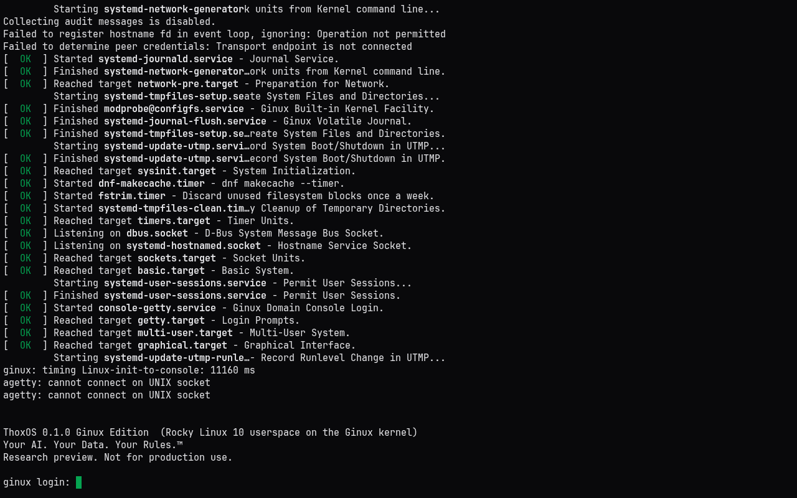
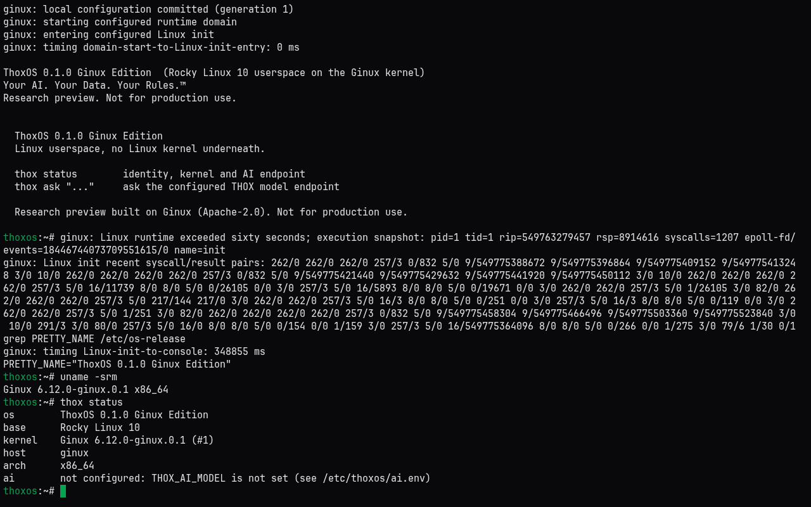

# ThoxOS Ginux Edition

[](LICENSE)
[](https://github.com/ttracx/thoxos-ginux/commits/ginux-edition-0.1.0)
[](https://thox.ai)
[](https://github.com/ttracx/thoxos-ginux/actions/workflows/ginux-edition-ci.yml)
[](docs/REVIEW.md)

ThoxOS userspace on the Ginux kernel: Linux programs, no Linux kernel underneath. Ginux is Gregory Kurtzer's independent Rust kernel, built with an AI coding agent in 11 days. This edition patches it for portable QEMU hosts and a private, offline image source, gives it a ThoxOS identity (os-release, banner, `thox` CLI with a local-model `thox ask`), and ships it two ways: a Docker demo that runs anywhere, and an external-SSD image that boots KnightHub into a Debian host running Ginux under KVM.

Your AI. Your Data. Your Rules.™





## Quick start

```bash
EXTRA_CA=/path/to/proxy-ca.pem make demo-image   # EXTRA_CA only behind a TLS-inspecting proxy
make selftest                                     # headless boot gate: welcome + login prompt
make demo-shell                                   # ThoxOS shell on the Ginux kernel (Ctrl-A then X quits)
make demo                                         # full systemd boot on the console
```

KnightHub external SSD:

```bash
make ssd-image                                    # build/ssd/thoxos-ginux-knighthub-0.1.0.img
sudo installer/install-to-ssd.sh --image build/ssd/thoxos-ginux-knighthub-0.1.0.img --device /dev/sdX
```

On Windows use `installer/Install-ThoxOSGinux.ps1` or Rufus in DD mode. Full steps: [docs/QUICKSTART.md](docs/QUICKSTART.md).

## Repository layout

| Path | Contents |
|---|---|
| `patches/` | ThoxOS changes to upstream Ginux (QEMU portability, banner, scoped registry root) |
| `scripts/` | Source preparation, per-build PKI, EFI build, proxy CA helper |
| `rootfs/` | ThoxOS userspace image: Containerfile, identity overlay, `thox` CLI |
| `runtime/` | `thoxos-g` launcher and console driver, registry and DNS configuration |
| `docker/` | Demo image and entrypoint |
| `installer/` | KnightHub host root, disk assembly, Linux and Windows writers |
| `tests/` | Unit tests, fake QEMU, end-to-end boot scripts |
| `docs/` | Review, guides, decisions, validation, queue, previews, closeout report (`docs/report/`: Word, PDF, content source) |

## Documentation

| Document | For |
|---|---|
| [docs/REVIEW.md](docs/REVIEW.md) | The Ginux review: what it is, findings, limits |
| [docs/USER_GUIDE.md](docs/USER_GUIDE.md) | Every workflow, configuration, troubleshooting |
| [docs/QUICKSTART.md](docs/QUICKSTART.md) | Zero to a booted console |
| [docs/DEVELOPMENT.md](docs/DEVELOPMENT.md) | Architecture, build, patch workflow, limits |
| [docs/VALIDATION.md](docs/VALIDATION.md) | What ran, with evidence; what did not |
| [docs/DECISIONS.md](docs/DECISIONS.md), [docs/DEV_QUEUE.md](docs/DEV_QUEUE.md) | Decision log and prioritized queue |
| [ecosystem_map.md](ecosystem_map.md) | Where this sits in THOX |
| [docs/report/](docs/report/), [HTML preview](docs/previews/thoxos-ginux-edition-report.html) | Closeout report in the THOX template (Word, PDF, HTML) |

## Releases

No release yet. The first tag follows hardware acceptance on KnightHub ([docs/DEV_QUEUE.md](docs/DEV_QUEUE.md) item 1). See [Releases](https://github.com/ttracx/thoxos-ginux/releases).

## Agent handoff

Agents start at [.agents/HANDOFF.md](.agents/HANDOFF.md).

## License

Apache-2.0, matching upstream Ginux ([LICENSE](LICENSE)). THOX.ai LLC intellectual property notice, trademarks and every upstream attribution: [NOTICE.md](NOTICE.md).
