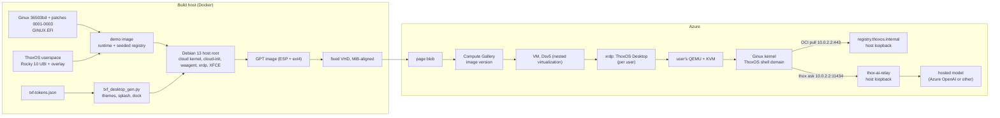

# ThoxOS Ginux Edition on Azure

ThoxOS Ginux Edition 0.2.0 builds two Azure images: **desktop** (ThoxOS Desktop over RDP) and **headless** (SSH and the serial console). Each VM runs ThoxOS on the Ginux kernel under nested KVM, one Ginux VM per user.

## Azure Virtual Desktop: what applies and what does not

Microsoft's guide [Prepare and customize a VHD image of Azure Virtual Desktop](https://learn.microsoft.com/en-us/azure/virtual-desktop/set-up-customize-master-image) builds a Windows golden image. Azure Virtual Desktop session hosts must run Windows: the [prerequisites](https://learn.microsoft.com/azure/virtual-desktop/prerequisites) list Windows 11 and 10 Enterprise (multi-session), and Windows Server 2016 to 2025, and no Linux. So a ThoxOS image cannot join an AVD host pool. It follows the same golden-image flow and runs as a standard Azure VM:

| Guide step (Windows) | ThoxOS Ginux Edition (Linux) |
|---|---|
| Start from Windows 10 Enterprise multi-session | Start from Debian 13 with the Azure cloud kernel (`linux-image-cloud-amd64`) |
| Generation 1 VM | Generation 2 (UEFI, GPT, systemd-boot). Standard security type: the boot loader is unsigned, so Trusted Launch and Secure Boot are off |
| Disable checkpoints, convert to a fixed VHD | Built offline; `azure/build-vhd.sh` writes a fixed VHD whose size is a whole number of MiB and verifies the footer |
| Office, FSLogix, Defender exclusions, Windows Update, Storage Sense, time zone redirection | Not applicable. The Linux equivalents: Hyper-V drivers in the initrd, cloud-init with the Azure datasource, the Azure Linux Agent with provisioning handed to cloud-init, serial console on ttyS0, chrony on the Hyper-V PTP clock, no swap on the OS disk |
| Generalize with Sysprep | The image is never booted before upload: empty machine-id (and no D-Bus copy of one), no SSH host keys, no xrdp keys, no login account. First boot creates all of them |
| Upload the VHD as a page blob, create an image | `azure/publish-image.sh` uploads a page blob and creates an Azure Compute Gallery image definition (Linux, generalized, V2, standard security) and version |
| Create host pools | `azure/azuredeploy.json` deploys a VM from the gallery image |

If Azure Virtual Desktop itself is a requirement, the supported pattern is a Windows host pool that publishes Remote Desktop Connection as a RemoteApp pointed at the ThoxOS VM. That is not built in 0.2.0.

## Architecture



## Build

```bash
make demo-image      # Ginux kernel from source, ThoxOS userspace, runtime (once)
bash installer/build-host-image.sh --target azure --desktop desktop \
    --demo-image thoxos-g/demo:0.1.0 --host-image thoxos-g/azure-desktop-host:0.2.0 \
    --size 8G --out build/azure          # build/azure/thoxos-ginux-azure-desktop-0.2.0.vhd
bash installer/build-host-image.sh --target azure --desktop headless \
    --demo-image thoxos-g/demo:0.1.0 --host-image thoxos-g/azure-headless-host:0.2.0 \
    --size 8G --out build/azure          # build/azure/thoxos-ginux-azure-headless-0.2.0.vhd
bash tests/e2e/boot-azure-image.sh build/azure/thoxos-ginux-azure-desktop-0.2.0.vhd build/e2e-azure 600
```

`make azure-image` (`AZURE_DESKTOP=desktop|headless`) and `make azure-boot` wrap the same scripts. Each build writes the VHD, its `.sha256` and a `.manifest.json` (kernel, GINUX.EFI hash, partition IDs). The VHD is 8 GiB (about 2 GB of data); the VM's OS disk can be larger and the root partition grows on first boot.

The bench (`tests/e2e/boot-azure-image.sh VHD OUT [GINUX_WAIT]`) boots the VHD in QEMU through a 20 GiB overlay, provisions it with a NoCloud seed the way Azure's cloud-init datasource would, checks it over SSH, captures the splash, the LightDM greeter, the xrdp login and one RDP session per look, and with `GINUX_WAIT` greater than 0 opens ThoxOS on Ginux inside the desktop. A VHD named `*-headless-*` gets the headless checks and a full systemd boot of ThoxOS on Ginux for the administrator.

## Publish to a gallery

```bash
az login
azure/publish-image.sh --vhd build/azure/thoxos-ginux-azure-desktop-0.2.0.vhd \
    --resource-group thoxos-images --location eastus
# prints: imageVersionId=/subscriptions/.../galleries/thoxos_gallery/images/thoxos-ginux-desktop/versions/0.2.0
```

The script checks the VHD, creates the resource group, a storage account without public blob access, the `vhds` container, the gallery, the image definition (`--os-type Linux --os-state Generalized --hyper-v-generation V2`, `SecurityType=Standard`, accelerated networking off) and the image version. Uploads use your Entra ID sign-in (Storage Blob Data Contributor on the account), and `azcopy` when it is installed.

## Deploy a VM

```bash
az deployment group create --resource-group thoxos-demo \
    --template-file azure/azuredeploy.json \
    --parameters imageVersionId="$IMAGE_VERSION_ID" \
                 allowedSourceCidr="203.0.113.7/32" \
                 adminPasswordOrKey="$ADMIN_PASSWORD" \
                 desktopLook=slate
```

| Parameter | Default | Meaning |
|---|---|---|
| `imageVersionId` | (required) | Gallery image version from `publish-image.sh` |
| `allowedSourceCidr` | (required) | The only source range that reaches SSH and RDP |
| `adminPasswordOrKey` | (required) | Administrator password (RDP needs one) or SSH public key with `authenticationType=sshPublicKey` |
| `vmSize` | `Standard_D4s_v5` | A size with nested virtualization, so Ginux runs under KVM. Without it QEMU falls back to software emulation |
| `osDiskSizeGB` | 64 | Root grows to fill it on first boot |
| `enableRdp` | true | Open 3389 (set false for headless) |
| `desktopLook` | `slate` | `slate`, `porcelain` or `console-pro` for new users |

The VM has a static public IP with a DNS label, an NSG that admits SSH (and RDP) only from `allowedSourceCidr`, accelerated networking off, boot diagnostics on (serial console and screenshot), and the OS disk on Premium SSD.

## Connect

- RDP to the VM's FQDN, sign in as the administrator. The xrdp login screen and the desktop carry the ThoxOS look.
- SSH: `ssh thox@FQDN`, then `thoxos-ginux shell` for ThoxOS on Ginux in the terminal.
- Azure serial console: login on ttyS0 for recovery.

## Hosted AI routing

`thox ask` on the VM and inside ThoxOS on Ginux both reach `127.0.0.1:11434` (inside Ginux: `10.0.2.2:11434`). On Azure there is no local model, so `thox-ai-relay` can serve that port and forward to a hosted OpenAI-compatible endpoint:

| Upstream | `THOX_RELAY_UPSTREAM` | `THOX_RELAY_AUTH` |
|---|---|---|
| Azure OpenAI (v1 API) | `https://RESOURCE.openai.azure.com/openai/v1` | `api-key` |
| Anthropic, OpenAI SDK compatibility | `https://api.anthropic.com/v1` | `bearer` |

The VM starts with hosted AI off. The ARM template accepts no model API key and its custom data configures only the desktop look. Base64 custom data can be retained in guest provisioning files; a `securestring` parameter or a Key Vault parameter reference would not protect a key copied into that script.

After provisioning, connect through the restricted SSH or administrator session. For a new relay configuration:

```bash
sudo install -o root -g thoxos-ai -m 0640 \
    /etc/thoxos/ai-relay.env.example /etc/thoxos/ai-relay.env
sudoedit /etc/thoxos/ai-relay.env
sudo -u thoxos-ai python3 -I /usr/lib/thoxos-g/thox_ai_relay.py --check
sudo systemctl restart thox-ai-relay.service
curl --fail http://127.0.0.1:11434/healthz
```

Set the final HTTPS upstream URL, auth scheme, model or deployment name and key in that host file. Edit an existing configuration directly rather than replacing it with the example. Keep credentials out of command arguments, deployment parameters, custom data and image builds. The file is owned by root and readable only by root and the relay's `thoxos-ai` group. Automated managed-identity retrieval from Key Vault is not implemented by this template.

Clients ask for model `thox-hosted`. The relay listens on loopback only, refuses streaming and upstream redirects, caps requests at 1 MiB, rate-limits to 30 requests a minute and never logs bodies or keys. Configure the final endpoint directly; a redirect returns 502 and no second request is sent. Every local user shares the key and the limit. The health check confirms relay availability, not a successful hosted-model completion; test `thox ask` separately after configuring a real endpoint.

## Security notes

- Ginux is a research prototype with no security audit. Keep the VM on a restricted source range; never open it to the internet.
- No account, key material or machine ID ships in the image; cloud-init, `thoxos-g-hostkeys`, `thoxos-desktop-firstboot` and systemd create them per machine. The D-Bus machine ID is a link to `/etc/machine-id`, so it cannot carry a build-time ID onto every VM (VALIDATION D-16).
- The per-build registry root (patch 0003) is trusted only for `registry.thoxos.internal`, which resolves to the host's loopback. Its private key was destroyed at build time.
- Each desktop user's Ginux VM runs as that user; KVM access comes from the `kvm` group.

## Troubleshooting

| Symptom | Cause and fix |
|---|---|
| Deployment ends with `OSProvisioningTimedOut` | cloud-init did not report ready. Check boot diagnostics and the serial console log for cloud-init errors |
| "Ginux runs without KVM (slow)" in the terminal | The VM size has no nested virtualization, or the user is not in `kvm`. Pick a Dsv5 size |
| RDP connects to a black screen | The session is starting (first login builds the user's settings). Wait, or reconnect |
| `thox ask` says it cannot reach 127.0.0.1:11434 | No relay configured. Fill `/etc/thoxos/ai-relay.env` and `sudo systemctl restart thox-ai-relay` |
| Image creation rejects the VHD | Run `python3 azure/vhd_check.py IMAGE.vhd`: it must be fixed and MiB-aligned |

## What is verified

[VALIDATION.md](VALIDATION.md) rows V20 to V35 hold the evidence. In short:

| Verified here (QEMU, software emulation) | Not run |
|---|---|
| Desktop VHD: 23 of 23 checks. SSH 43 s after power-on, cloud-init done (NoCloud seed), no failed units, per-machine keys and machine ID, Hyper-V modules in the initrd, agent settings, splash, console greeter, xrdp login, three looks over RDP, ThoxOS on Ginux inside the desktop (`uname` reports Ginux) | Anything on Azure: gallery upload, deployment, the Azure datasource and agent provisioning, Hyper-V devices, PTP time |
| Headless VHD: 13 of 13 checks, and a full systemd boot of ThoxOS on Ginux for the administrator | Nested KVM on a Dsv5 VM |
| VHD format checks, template references and port rules, the first-boot script with hostile input, relay behavior against a stub upstream | A hosted model behind the relay; Trusted Launch |
