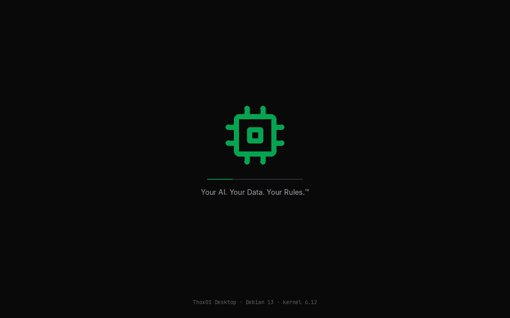
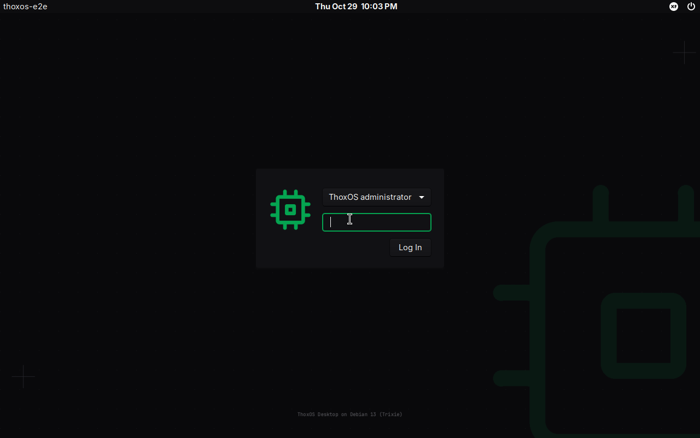
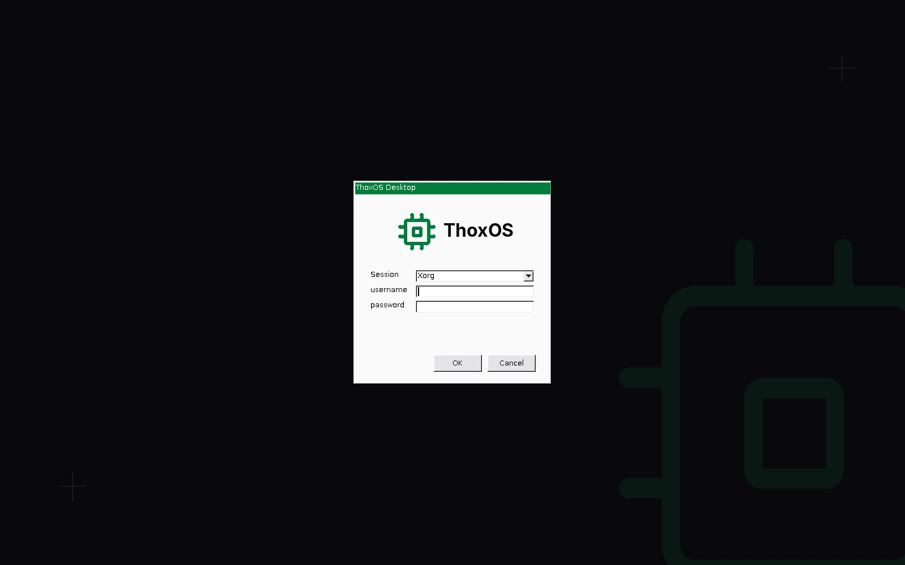
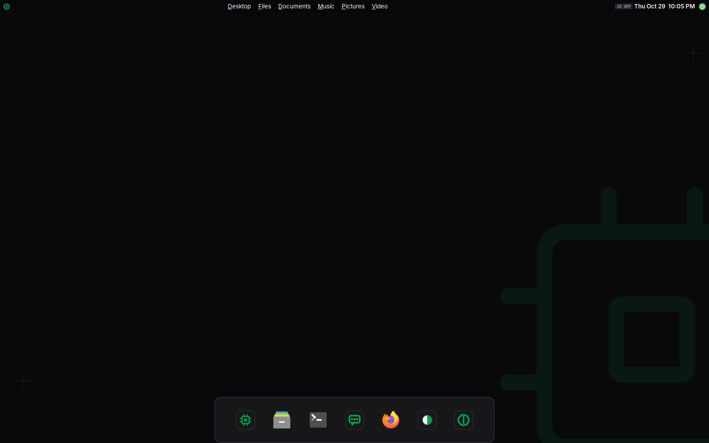
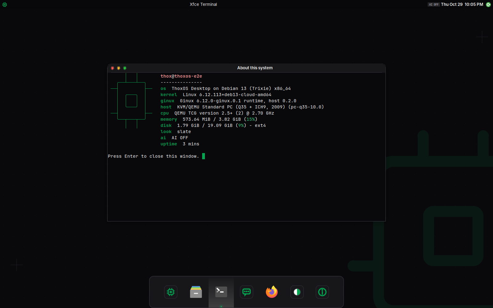
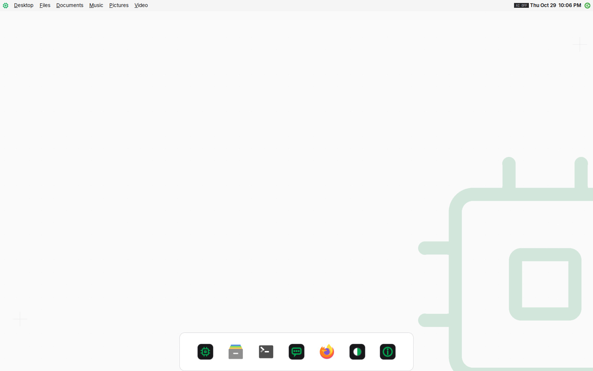
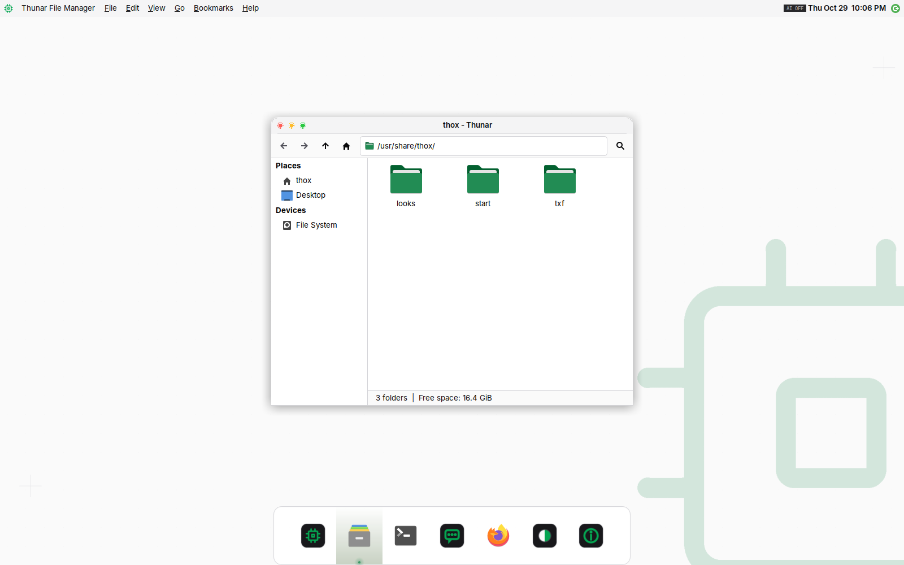
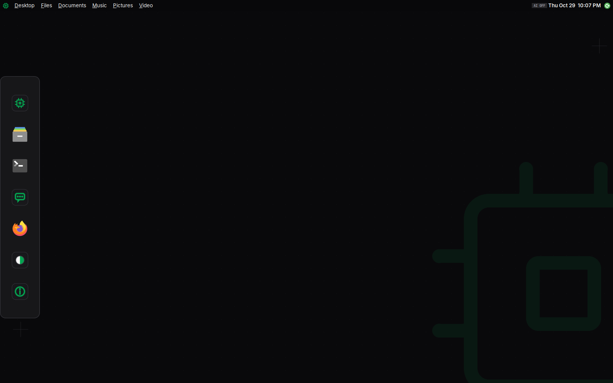
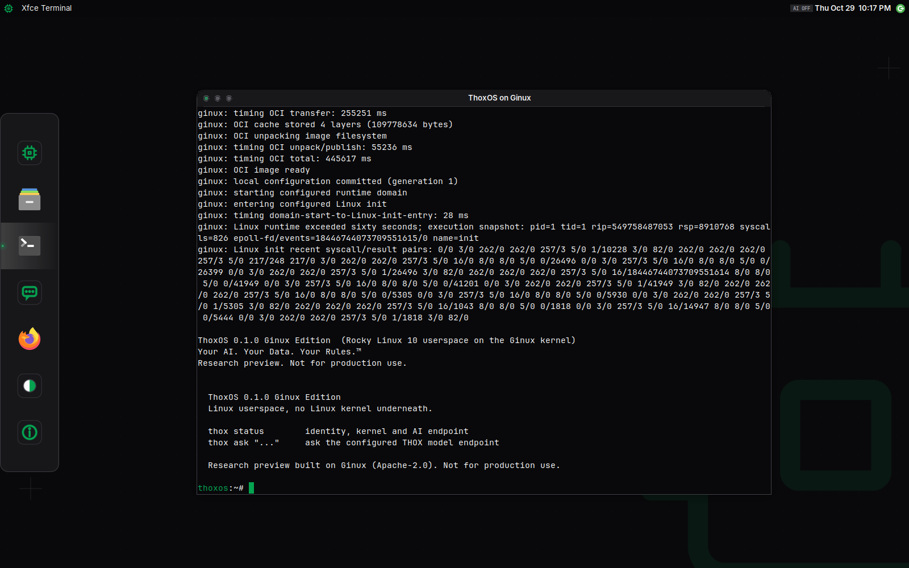
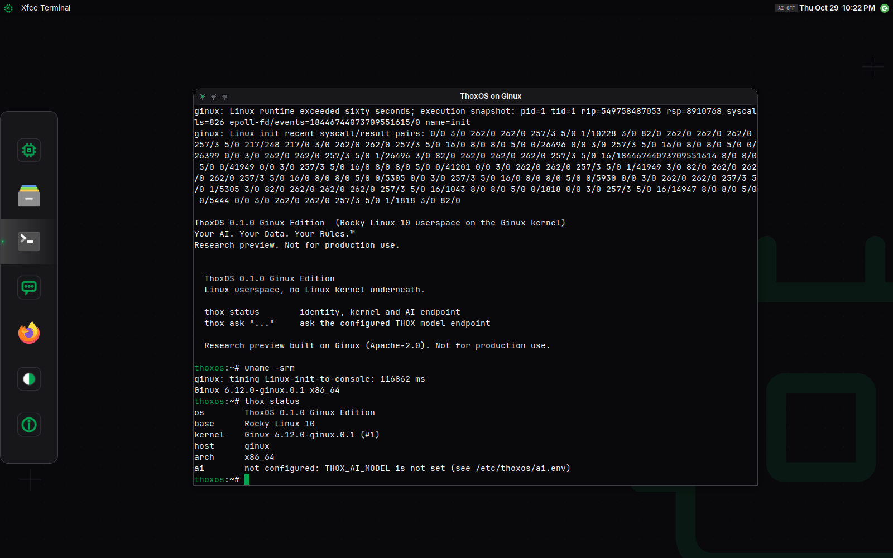

# ThoxOS Desktop on the Ginux Edition host

ThoxOS Ginux Edition 0.2.0 adds a desktop variant of the host: the TXF 5.2 **ThoxOS Desktop** (Debian 13, three looks) on XFCE 4.20, with ThoxOS on the Ginux kernel one click away in the dock. It ships in the Azure desktop image and can be built for KnightHub with the same Dockerfile.

## Provenance

| Item | Source |
|---|---|
| Design | TXF 5.2 Desktop Customization module, `design-systems/uploads/THOX_TXF_5_0_Design_System/templates/desktop-customization/` in ttracx/thox-experience-fabric at `adec4ae`, adopted by Tommy 2026-10-25 (ADR-0016) |
| Tokens | `desktop/tokens/txf-tokens.json`, copied unchanged from that folder; ships at `/usr/share/thox/txf/txf-tokens.json` |
| Light text and border values | Not in the token file's light set; taken from the THOX document tokens (DS 2.x lock: `#09090B`, `#52525B`, `#D4D4D8`) and named in the generator |
| Chip mark | THOX brand chip mark geometry (`thox-mark-green.svg`, 24-unit grid), redrawn by the generator |
| Window theme base | GTK's own Adwaita stylesheet (LGPL-2.1+), recolored by the generator |
| Folder icons | Papirus icon theme (GPL-3.0), folders recolored to TXF green in derived themes |

**Contradiction for a ruling.** `design-systems/txf-5/DESKTOP-VARIANTS.json` names `ttracx/thoxos-desktop` as the canonical repository for ThoxOS Desktop. That repository's tree (main at `1996b86`) holds the Ubuntu 26.10 + KDE Plasma workstation tooling and no Debian 13 implementation. This implementation therefore lives in `ginux-edition/desktop/`. It follows the 5.2 variant's base, looks and lineage rules and does not copy ThoxOS Vibe or ThoxOS Plasma looks. Where it should live long term is Tommy's call.

## Looks

| Look | Appearance | Layout | Window chrome |
|---|---|---|---|
| TXF Slate (default) | Dark, canvas `#09090B`, surface `#18181B` | Top bar, floating dock at the bottom | Authentic traffic lights, left |
| Porcelain | Light, canvas `#FAFAFA`, action green `#047C3D`, soft-green selection `#E7F6EE` | Top bar, floating dock at the bottom | Authentic traffic lights, left |
| Console Pro | Dark | Top bar, dock on the left | TXF mono: zinc controls with a green close glyph |

Switch looks with **ThoxOS Looks** in the dock or launcher, or:

```bash
thoxos-look list
thoxos-look set porcelain            # this user, applied now and at every login
sudo thoxos-look system-default console-pro   # users who never chose
thoxos-look off                      # keep your own XFCE settings
```

On Azure, the deployment parameter `desktopLook` sets the system default.

## What the desktop holds

| Item | What it does |
|---|---|
| ThoxOS on Ginux | Terminal running `thoxos-ginux shell`: the user's own Ginux VM boots and pulls ThoxOS from the host's private registry |
| ThoxOS System Boot | `thoxos-ginux system`: the systemd boot of ThoxOS on Ginux to its login prompt |
| Ask THOX | `thox ask` against 127.0.0.1:11434 (a local model server, or `thox-ai-relay` for a hosted model). In the launcher, `?` followed by a question asks directly |
| Top bar chip | LOCAL (green), HOSTED (amber) or AI OFF, from `thoxos-ai-chip` |
| About this system | `fastfetch` with the ThoxOS identity, kernel, Ginux runtime, look and AI route (the window stays open until Enter) |
| ThoxOS Doctor | `thoxos-ginux doctor`: QEMU, firmware and KVM checks for this user |
| Files, Terminal, Firefox ESR | Thunar, xfce4-terminal with the TXF palette, Firefox with a local TXF start page and telemetry off |

Every user gets an own Ginux VM and state directory (`~/.local/state/thoxos-g`), 2 GiB of RAM each.

## Screenshots

Captured from the final Azure desktop VHD booted in QEMU (software emulation) by `tests/e2e/boot-azure-image.sh`, over RDP at 1600 x 1000 unless noted. They show the shipped image, not Azure (VALIDATION V26 to V29).

| Capture | What it shows |
|---|---|
|  | Plymouth ThoxOS splash on the VGA console |
|  | LightDM greeter on the VGA console |
|  | xrdp login screen |
|  | TXF Slate: top bar, AI chip, dock |
|  | TXF Slate with About this system |
|  | Porcelain |
|  | Porcelain with the file manager and green folders |
|  | Console Pro: left dock, mono window chrome |
|  | ThoxOS on Ginux after the OCI pull, at the ThoxOS shell |
|  | `uname -srm` and `thox status` on the Ginux kernel |

## The 17 surfaces of TXF 5.2

| # | Surface | State in 0.2.0 | Notes |
|---|---|---|---|
| 1 | Boot menu and splash | Shipped (splash) | Plymouth script theme: chip mark, hairline progress bar, slogan, base-truth footer. systemd-boot itself is unstyled |
| 2 | Login greeter | Shipped | LightDM GTK greeter on the console (Azure's Hyper-V framebuffer and the UEFI framebuffer are graphical seats); branded xrdp login for RDP. No large clock (the greeter has no widget for it) |
| 3 | Wallpapers | Shipped | Dark and light, dot grid, chip watermark, generated |
| 4 | Icon theme | Partial | Papirus with TXF-green folders (generic names linked too); six generated ThoxOS launcher icons (chip, power, bubble, info, split disc, pulse). The redrawn TXF icon set is not built |
| 5 | Cursors | Not shipped | Adwaita cursors |
| 6 | Shell | Partial | Top bar (30 px, global menu, AI chip, clock, one log-out button), dock (tile 46, radius 14), launcher with search actions. Plank cannot float the dock above the screen edge, so it sits on the edge. Notifications use the stock XFCE daemon; no control center or custom OSDs |
| 7 | Window decorations | Shipped | Left buttons, radius 12 at the top corners, TXF borders; mono chrome in Console Pro. Bottom corners are square |
| 8 | App themes | Partial | GTK 3 themes generated from the tokens (dark and light, AA contrast checked). No GTK 4 or Qt themes |
| 9 | Type | Shipped | Inter for UI, JetBrains Mono for terminal and code |
| 10 | Terminal | Shipped | 16-color TXF palette per look, generated |
| 11 | Editor | Not shipped | VS Code is not in Debian; Mousepad is the editor |
| 12 | Browser | Partial | Firefox ESR policies and the TXF start page; no Firefox theme add-on |
| 13 | Files | Shipped | Thunar on the TXF GTK theme with green folders and soft-green selection |
| 14 | Lock screen | Not shipped | No locker in RDP sessions |
| 15 | Identity | Shipped | `/etc/os-release`: "ThoxOS Desktop on Debian 13 (Trixie)", variant Ginux Edition; console login banner; fastfetch with the chip mark in box-drawing characters |
| 16 | Sound | Recorded decision | Deliberate mute: no sound theme or audio stack in the image (RDP sessions carry no audio) |
| 17 | Token source | Shipped | One token file in the image; `desktop/generator/txf_desktop_gen.py` derives every generated theme from it and fails the build on `#10B981` or `#00FF88` |

## How it is built

`installer/host/Dockerfile` stage `desktop-gen-desktop` installs GTK, Pillow, Inter, JetBrains Mono and Papirus, extracts Adwaita's stylesheets from libgtk-3, and runs the generator. The host stage copies the result, plus `desktop/overlay/` (panel, dock, greeter, launchers, first-boot unit) and `desktop/bin/`. The generator's checks (AA contrast for body text, brand locks) stop the build when they fail.

## Limits

- Ginux has no graphics: ThoxOS on Ginux is a console inside the desktop, not a desktop of its own.
- The look switcher writes XFCE settings; a user who customizes XFCE by hand should run `thoxos-look off`.
- The global menu relies on the appmenu GTK module; applications that do not export menus show only their name. With the desktop focused it lists the XDG folders (Desktop, Documents, Music, Pictures, Videos), which `xdg-user-dirs` creates at first login.
- ThoxOS on Ginux, Ask THOX and About run in xfce4-terminal, so a running one lights the terminal icon in the dock (seen for windows started outside the dock).
