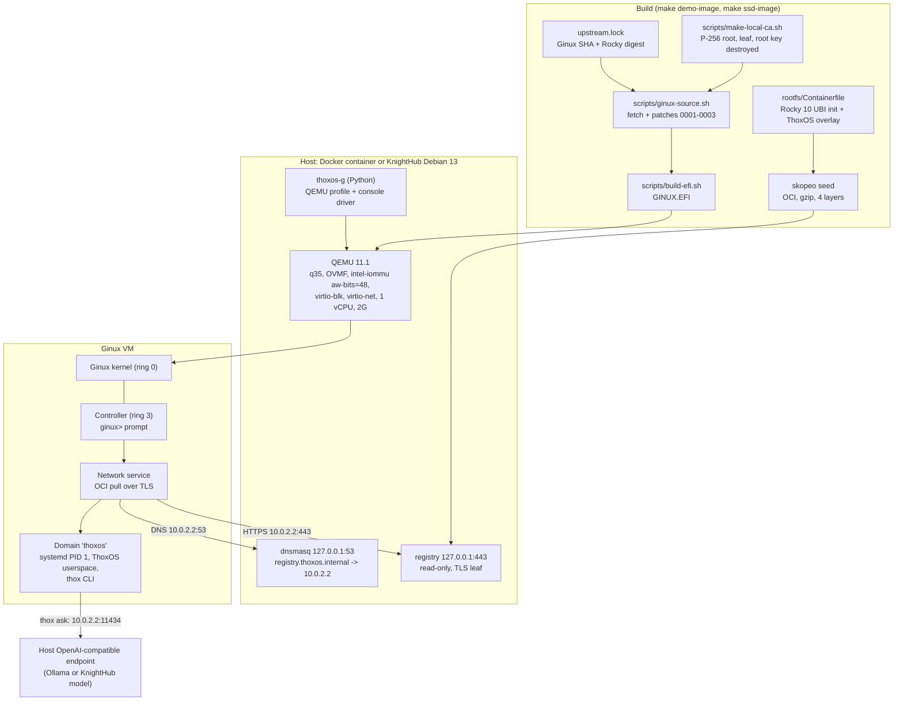

# Development

Developer handoff for ThoxOS Ginux Edition. User-facing docs: [USER_GUIDE.md](USER_GUIDE.md), [QUICKSTART.md](QUICKSTART.md).

## Architecture

Three layers in one slice:

| Layer | Component | Files |
|---|---|---|
| AI | `thox ask` sends prompts to any OpenAI-compatible endpoint on the host (`/etc/thoxos/ai.env`); `thox status` reports it | `rootfs/overlay/usr/local/bin/thox`, `rootfs/overlay/etc/thoxos/ai.env` |
| Backend | Patched Ginux, local PKI, read-only TLS registry, DNS forwarder, QEMU profile and controller driver, host services | `patches/`, `scripts/`, `runtime/`, `docker/`, `installer/host/` |
| Frontend | Serial console (Docker `-it`, KnightHub tty1) and browser console (ttyd, THOX theme, one client, generated credential) | `docker/entrypoint.sh`, `installer/host/overlay/etc/systemd/system/thoxos-g-console.service` |

## Why it is built this way

- Ginux drives only QEMU's virtio devices, so every ThoxOS target runs Ginux inside QEMU. KnightHub keeps a Debian kernel for its real NVMe, USB, NIC and GPU, and hands Ginux KVM.
- Ginux pulls userspace only over HTTPS on port 443 and trusts two pinned roots. Patch 0003 adds one more root, generated per build and accepted for exactly `registry.thoxos.internal`. Its private key is destroyed after signing the registry leaf, so nothing else can ever be signed under it.
- The registry and DNS bind to host loopback; QEMU user networking maps the guest's 10.0.2.2 to it. Nothing in the guest is reachable from outside (no `hostfwd`).
- `thoxos-g` owns the QEMU command line in one tested function, so the Docker demo and the SSD host cannot drift.

## Setup

| Need | Version used |
|---|---|
| Docker with BuildKit | 29.9 |
| Python | 3.11 or newer (3.13 used) with pytest |
| For `make efi` only | rustup, clang, git, openssl |

## Build and test

| Command | What it does | Time on 2 cores (no KVM) |
|---|---|---|
| `make test` | 70 pytest cases plus `bash -n` and shellcheck when installed | 2 s |
| `make demo-image` | Userspace image, then the four-stage demo image | Cold build not timed in this pass (it compiles Ginux); under 1 min with a warm cache |
| `make selftest` | Boots ThoxOS in Docker until `login:` | 53 s measured (TCG, 2 vCPU build host, includes the 41 s OCI pull) |
| `make ssd-image` | Host root plus 8 GiB GPT disk image in `build/ssd/` | 6 min cold, 1 min with a warm cache |
| `tests/e2e/boot-ssd-image.sh IMG OUT` | Boots the SSD image as a USB disk in QEMU, checks host services, captures tty1 | 2 min 14 s measured on the final image (TCG) |

Behind a TLS-inspecting proxy add `EXTRA_CA=/path/ca.pem`; the CA reaches only the RUN steps that fetch (BuildKit secret).

## Patch workflow

1. `bash scripts/ginux-source.sh build/ginux-src` (pinned commit plus current patches).
2. Edit inside `build/ginux-src`, commit there with a message that explains the upstream reason.
3. `git -C build/ginux-src format-patch -o ../../patches <GINUX_COMMIT>` and renumber.
4. Rebuild and run `make selftest`. A patch that cannot pass the selftest does not ship.

## Conventions

- Commit messages: imperative subject, body explains why. `docs:` prefix for documentation-only commits.
- Shell: `set -euo pipefail`, `fail()` helper, no unquoted expansions.
- Python: stdlib only in anything that ships into an image; type hints everywhere.
- Every pinned input (Ginux SHA, image digests, ttyd checksum) lives next to the code that uses it, with a comment saying why.

## Work log

| Date | Change |
|---|---|
| 2026-10-28 | 0.1.0: review, patches 0001-0003, ThoxOS userspace, Docker demo, KnightHub SSD image, installers, tests |

## Known limits

- Ginux limits apply in full (see [REVIEW.md](REVIEW.md)): one vCPU, VM RAM at most 2816 MiB, virtio-only devices, no audit, development signing key.
- The KnightHub path is validated in QEMU with a USB disk and an e1000e NIC, not yet on KnightHub hardware.
- `Install-ThoxOSGinux.ps1` is written to the same guard list as `install-to-ssd.sh` but has not run on Windows.
- Secure Boot is unsupported on the SSD (unsigned systemd-boot).
- The guest hostname is `ginux` (kernel constant).

## Roadmap

See [DEV_QUEUE.md](DEV_QUEUE.md).
