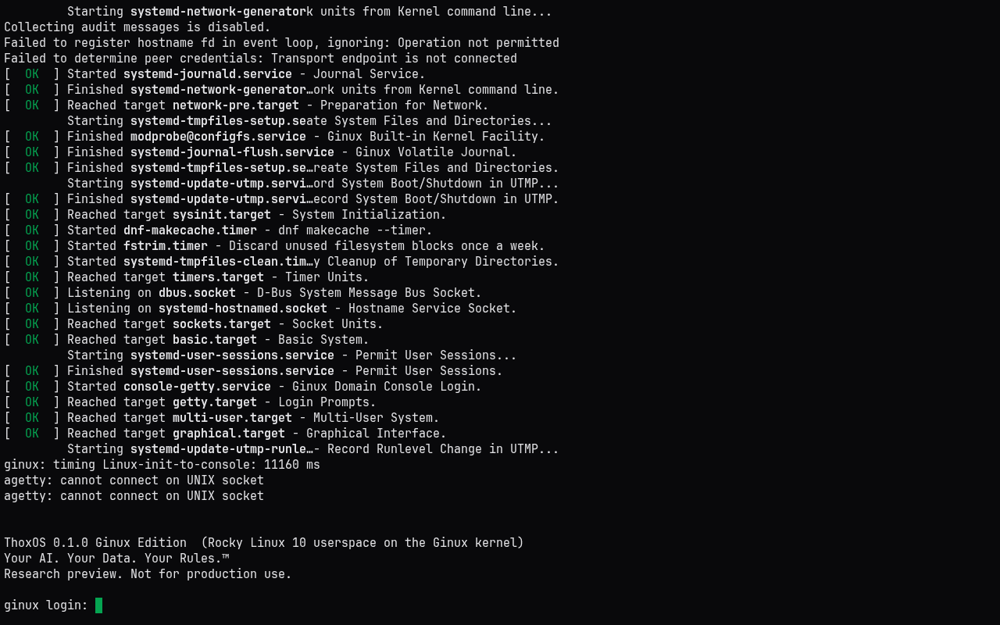
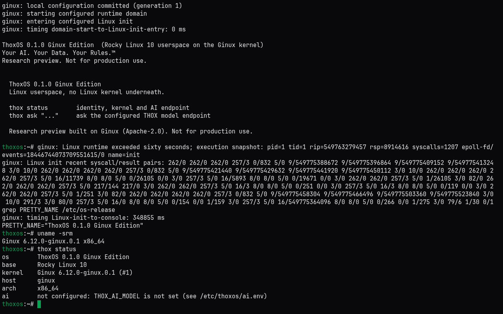
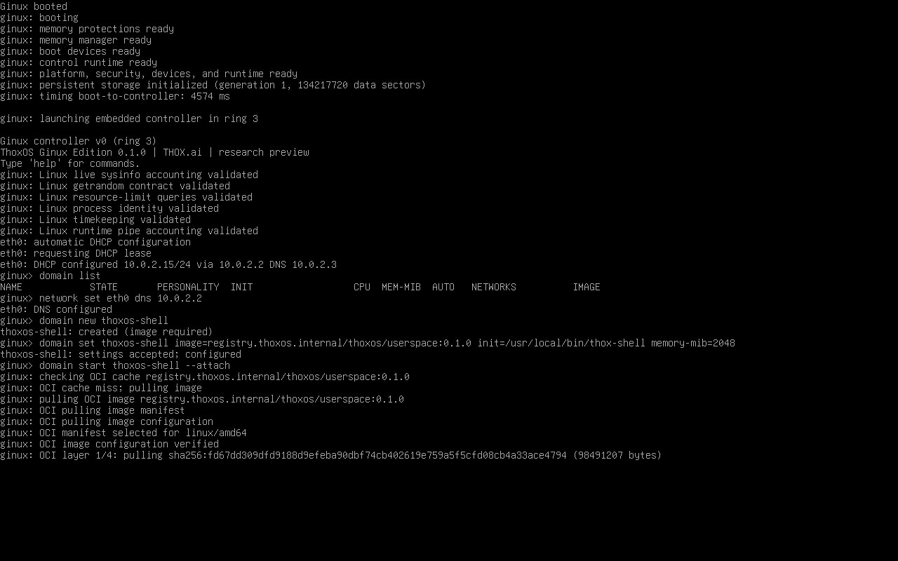
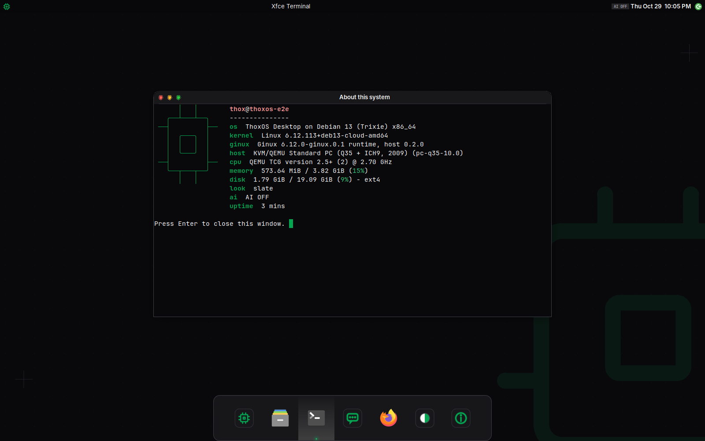
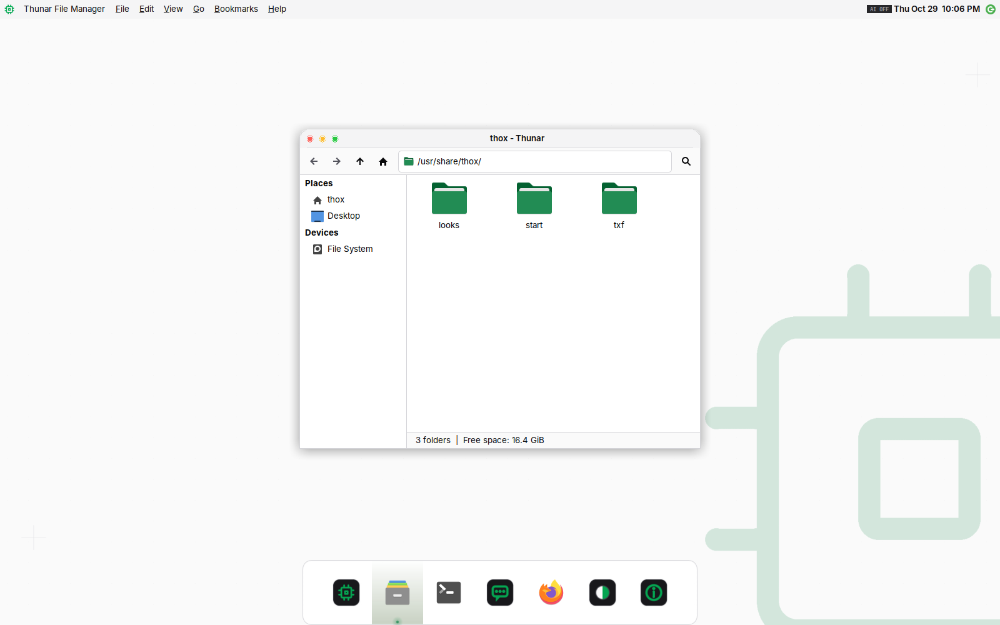

# ThoxOS Ginux Edition user guide

## What it is

ThoxOS Ginux Edition runs a ThoxOS userspace (Rocky Linux 10 base with ThoxOS identity and the `thox` command) on Ginux, an independent Rust kernel that speaks the Linux system-call interface. No Linux kernel runs underneath the ThoxOS programs. Ginux runs inside QEMU with the hardware profile it was built for; on KnightHub a small Debian host provides the real drivers and KVM.

Version 0.2.0 adds two host targets beside KnightHub: Azure VM images, one with **ThoxOS Desktop** (the TXF 5.2 desktop, three looks, reached over RDP) and one headless. The Ginux guest is unchanged at 0.1.0.

It is a research preview for demos and exploration. It is not a product OS: Ginux has one CPU, at most 2.75 GiB of RAM, only virtual devices, and no security audit (see [REVIEW.md](REVIEW.md)).

Who it is for: THOX engineering and anyone giving a "Linux userspace without Linux" demo.

## What happens at boot

1. UEFI firmware (OVMF) loads `GINUX.EFI`.
2. Ginux starts its controller and prints the `ginux>` prompt with the ThoxOS banner.
3. `thoxos-g` types the setup for you: DNS to the host forwarder, `domain new thoxos` (first boot only), `domain set ...`, `domain start thoxos --attach`.
4. Ginux pulls the ThoxOS image from the host's read-only registry (`registry.thoxos.internal`), verifies every layer, unpacks it, and starts systemd.
5. systemd prints `Welcome to ThoxOS 0.1.0 Ginux Edition!` and reaches `multi-user.target`; the console shows the ThoxOS banner and `ginux login:`.

The first boot pulls about 110 MB. Later boots reuse the cache in the persistent volume.

## Workflows

### Docker demo, terminal

```bash
make demo
```

Keys: `Ctrl-]` belongs to Ginux (detach from the domain to the `ginux>` prompt; `domain attach thoxos` returns). `Ctrl-A` then `X` stops the VM and exits. `Ctrl-A` `Ctrl-A` sends a literal Ctrl-A.

### Docker demo, browser

```bash
make demo-web
```

Open http://127.0.0.1:7681. The log prints a generated credential (`thox:...`); set your own with `-e THOXOS_G_WEB_CREDENTIAL=user:password`. One browser session at a time, because each session boots the VM on the same volume.



For a ThoxOS shell in the browser instead of the systemd boot, set the mode:

```bash
docker run --rm -e THOXOS_G_MODE=shell -p 127.0.0.1:7681:7681 \
  -v thoxos-g-state:/var/lib/thoxos-g/state thoxos-g/demo:0.1.0 web
```



Ginux prints one diagnostic block (`Linux runtime exceeded sixty seconds; execution snapshot ...`) when a domain has run for a minute. It is informational; the shell keeps working.

### Shell access

ThoxOS boots in one of two domains from the same image:

| Mode | Command | Init | Use it for |
|---|---|---|---|
| System | `make demo` (`thoxos-g console`) | systemd | The full boot: welcome line, units, `multi-user.target`, login prompt |
| Shell | `make demo-shell` (`thoxos-g console --shell`) | `/usr/local/bin/thox-shell` | A ThoxOS shell on the console: `thox status`, `thox ask`, any Rocky 10 program |

In shell mode, `exit` stops the domain and returns to the `ginux>` prompt. The two domains share one OCI cache, so the second one starts without a new pull.

The `ginux login:` prompt in system mode does not complete a password login on Ginux 36503bd (VALIDATION V9); use shell mode for an interactive session.

### AI: `thox ask`

`thox ask` sends a prompt to an OpenAI-compatible endpoint on the host. Inside ThoxOS, `10.0.2.2` is the host's loopback, so an Ollama or KnightHub model server on the host's `127.0.0.1:11434` is reachable without opening it to the network.

```bash
export THOX_AI_MODEL=<model name your server lists>
thox ask "What kernel am I running on?"
```

Set defaults in `/etc/thoxos/ai.env` (`THOX_AI_BASE_URL`, `THOX_AI_MODEL`, optional `THOX_AI_API_KEY` with the file at mode 0600, `THOX_AI_TIMEOUT`). No model ships in the image.

### KnightHub external SSD

Build and write:

```bash
make ssd-image
sudo installer/install-to-ssd.sh --image build/ssd/thoxos-ginux-knighthub-0.1.0.img --device /dev/sdX
```

The writer also takes the compressed image directly (`--image thoxos-ginux-knighthub-0.1.0.img.xz`); check it first with `sha256sum` against `docs/VALIDATION.md`.

On Windows (KnightHub): decompress a `.img.xz` with 7-Zip first, then use an elevated PowerShell, `.\installer\Install-ThoxOSGinux.ps1 -ImagePath  -DiskNumber <n>` (find `<n>` with `Get-Disk`), or Rufus in DD image mode.

Boot: disable Secure Boot in firmware setup, plug in the SSD, open the boot menu (F11 or F12 on most desktop boards), choose the SSD's UEFI entry. The boot menu offers:

| Entry | What it does |
|---|---|
| ThoxOS Ginux Edition (default) | Debian 13 host, ThoxOS console on tty1 with Ginux under KVM |
| Ginux bare-metal probe | Starts `GINUX.EFI` directly. Expected to stop: Ginux has no NVMe, USB or physical NIC drivers yet |



First boot grows the root partition to fill the SSD. tty1 is the ThoxOS console in shell mode (set `THOXOS_G_MODE=system` in `/etc/thoxos-g/thoxos-g.conf` for the full systemd boot). Ctrl-Alt-F2 gives the host admin login: user `thox`, initial password `thoxos` (or the one passed with `ADMIN_PASSWORD_FILE` at build), changed at first login.

Host commands: `systemctl status 'thoxos-g-*'`, `journalctl -u thoxos-g-console -b`, `sudo -u thoxos thoxos-g doctor`. `/etc/thoxos-g/README.host` lists them on the machine.

### ThoxOS Desktop

Desktop images (Azure desktop, or KnightHub built with `DESKTOP=desktop`) boot to a ThoxOS splash and a branded login: LightDM on the screen, xrdp for RDP. Every user gets the same desktop:

| Item | Where |
|---|---|
| ThoxOS on Ginux | Dock, first icon: a terminal boots the user's own Ginux VM into the ThoxOS shell |
| ThoxOS System Boot | Launcher: the systemd boot of ThoxOS on Ginux |
| Ask THOX | Dock, or type `?` then a question in the launcher |
| ThoxOS Looks | Dock: switch between TXF Slate, Porcelain and Console Pro |
| About this system | Dock: ThoxOS identity, kernel, Ginux runtime, look and AI route |
| AI chip | Top bar: LOCAL, HOSTED or AI OFF |



Looks from the command line: `thoxos-look list`, `thoxos-look set porcelain`, `sudo thoxos-look system-default console-pro`, `thoxos-look off` (keep your own XFCE settings). Details, provenance and the state of each TXF surface: [DESKTOP.md](DESKTOP.md).



### Azure

Build the VHD, publish it to an Azure Compute Gallery, deploy a VM from it, connect over RDP or SSH:

```bash
bash installer/build-host-image.sh --target azure --desktop desktop \
    --demo-image thoxos-g/demo:0.1.0 --host-image thoxos-g/azure-desktop-host:0.2.0 --size 8G --out build/azure
azure/publish-image.sh --vhd build/azure/thoxos-ginux-azure-desktop-0.2.0.vhd --resource-group thoxos-images --location eastus
az deployment group create --resource-group thoxos-demo --template-file azure/azuredeploy.json \
    --parameters imageVersionId=IMAGE_VERSION_ID allowedSourceCidr=YOUR.IP/32 adminPasswordOrKey=PASSWORD desktopLook=slate
```

Use `--desktop headless` for the SSH-only image. The VM size must support nested virtualization (default `Standard_D4s_v5`) for Ginux to run under KVM; otherwise QEMU falls back to software emulation. Azure Virtual Desktop cannot host this image (its session hosts are Windows only); [AZURE.md](AZURE.md) maps Microsoft's golden-image guide step by step and covers parameters, hosted AI and troubleshooting.

On a desktop image `thoxos-ginux shell`, `thoxos-ginux system` and `thoxos-ginux doctor` run Ginux for the calling user, with state in `~/.local/state/thoxos-g`. The KnightHub tty1 console service is off on desktop images.

## Configuration

`/etc/thoxos-g/thoxos-g.conf` (KEY=VALUE); environment variables of the same name override it.

Docker modes use the same explicit runtime-setting allowlist, including `web`
and `exec`. Pass supported settings with `docker run -e NAME=value`; values are
preserved as single arguments, including paths containing spaces. The runtime
child receives those settings and its home, terminal and language defaults after
the privilege change. Web credentials and unrelated container variables are not
forwarded to it. `shell` and `--shell` still force the shell domain.

| Setting | Default | Meaning |
|---|---|---|
| `THOXOS_G_MEMORY` | `2G` | VM RAM, 1G to 2816M (Ginux maps only the first 4 GiB) |
| `THOXOS_G_DOMAIN_MEMORY_MIB` | `2048` | Domain memory limit |
| `THOXOS_G_ACCEL` | `auto` | `kvm` when `/dev/kvm` is usable, else `tcg` |
| `THOXOS_G_VOLUME_SIZE` | `64G` | Sparse persistent volume (OCI cache, domain state) |
| `THOXOS_G_IMAGE` | `registry.thoxos.internal/thoxos/userspace:0.1.0` | Domain image |
| `THOXOS_G_DOMAIN` | `thoxos` | Domain name (25 characters max; shell mode uses `<name>-shell`) |
| `THOXOS_G_SHELL_INIT` | `/usr/local/bin/thox-shell` | Init for the shell domain |
| `THOXOS_G_MODE` | `system` (Docker), `shell` (KnightHub) | Which domain `thoxos-g console` boots; `--shell` forces shell |
| `THOXOS_G_DNS` | `10.0.2.2` | DNS server given to Ginux (host forwarder) |
| `THOXOS_G_BOOT_TIMEOUT` | `300` (Docker), `600` (KnightHub) | Seconds to wait for each boot milestone |
| `THOXOS_G_STATE_DIR` | `/var/lib/thoxos-g/state` | ESP copy, firmware variables, volume |
| `THOXOS_G_STATE_DIR` on desktop images | `~/.local/state/thoxos-g` | Set by `thoxos-ginux` for each user |
| `THOXOS_G_USERSPACE_MANIFEST` | `/usr/share/thoxos-g/userspace-manifest.json` | Manifest of the served userspace; a change replaces the volume |

## Troubleshooting

| Symptom | Cause and fix |
|---|---|
| `inactive IOMMU translation construction failed` | QEMU older than 9.1 without `aw-bits=48`. Use `thoxos-g` (it sets it) |
| `virtio network initialization invariant failed` | QEMU 10.0.x. Use QEMU 10.2 or newer (the image ships 11.1); `thoxos-g doctor` flags it |
| `loaded EFI image is outside the identity map` | VM RAM above 2.75 GiB. Keep `THOXOS_G_MEMORY` at 2816M or less |
| `another ThoxOS console is already running` | One VM per state directory. Close the other console or browser tab |
| `the ThoxOS userspace changed since this volume was filled` | Expected once after a rebuild: Ginux caches the userspace by tag, so `thoxos-g` starts a fresh volume and the next boot pulls the image again (about 40 s without KVM) |
| Boot is slow | No KVM. In Docker add `--device /dev/kvm` (`make demo` does when present) |
| `registry did not become ready` | See `/var/log/thoxos-g-registry.log` in the container |
| SSD not in the boot menu | Secure Boot is on, or the firmware hides USB boot; enable USB boot and disable Secure Boot |
| Azure deployment ends with `OSProvisioningTimedOut` | cloud-init did not report ready; read the serial log in boot diagnostics |
| "Ginux runs without KVM (slow)" on Azure | VM size without nested virtualization, or the user is not in `kvm`; use a Dsv5 size |
| `thox ask` cannot reach `127.0.0.1:11434` on Azure | No hosted model configured: fill `/etc/thoxos/ai-relay.env` and `sudo systemctl restart thox-ai-relay` |
| Writer refuses the disk | Read the message: mounted, not USB, too small, or labeled THOXOS. Each has its own flag or fix |

## FAQ

**Does Ginux replace Linux on KnightHub?** No. The Debian host owns the hardware; Ginux runs ThoxOS inside KVM.

**Can I use the 500 GB THOXOS SSD?** It carries ThoxOS Vibe. The writer refuses it unless you pass `--erase-existing-thoxos`, which destroys Vibe. Use a spare SSD.

**Is it secure?** It is a research kernel with no audit and a development signing key. No ports from the guest are exposed; keep it that way.

**Can it run in Azure Virtual Desktop?** Not as a session host: AVD session hosts run Windows. It runs as an Azure VM you reach over RDP; a Windows host pool can publish a RemoteApp that connects to it.

**Which AI does `thox ask` use on Azure?** None until an administrator configures the hosted relay after deployment. Follow [AZURE.md](AZURE.md#hosted-ai-routing) to edit the restricted host file `/etc/thoxos/ai-relay.env`. Model keys are not accepted in ARM parameters or custom data. Hosted endpoint acceptance remains unrun.

**Where does my data live?** In `volume.raw` under the state directory on the host.
