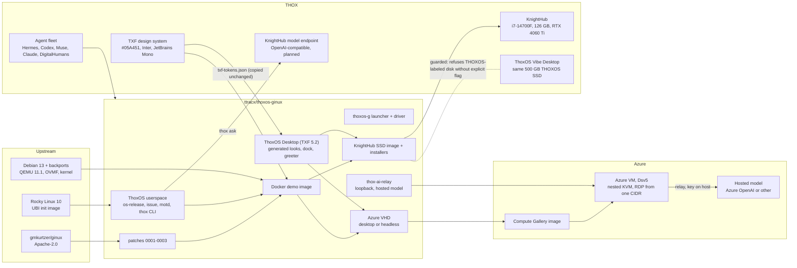

# Ecosystem map: ThoxOS Ginux Edition

## Where it sits

| Field | Value |
|---|---|
| Parent product | ThoxOS (THOX operating system family) |
| Sibling editions | ThoxOS Vibe Desktop (Pop!_OS + COSMIC, KnightHub external SSD), ThoxOS webby edition, ThoxOS iOS and Watch, ThoxOS Android |
| Role | Research and demo edition: ThoxOS identity and tooling on a non-Linux kernel (Ginux), shown in Docker anywhere, on KnightHub hardware and on Azure VMs, with ThoxOS Desktop (TXF 5.2) as the host desktop |
| Status | Host images 0.2.0, guest 0.1.0. Research preview. Not a product kernel |

## Upstream dependencies

| Dependency | Pin | Risk |
|---|---|---|
| Ginux | commit `36503bd` in `upstream.lock` | Research code, no audit, fast-moving; patches must be rebased per bump |
| Rocky 10 UBI init | digest in `upstream.lock` | Stable; userspace changes are file-only |
| QEMU 11.1 (trixie-backports) | Debian package | QEMU 10.0.x breaks Ginux virtio-net (F3) |
| Distribution registry v2, ttyd 1.7.7 | image digest, binary SHA-256 | Low |
| Debian cloud kernel (`linux-image-cloud-amd64`) | Debian 13 package | No DRM drivers: framebuffer-only console (seat rule in the Azure overlay) |
| cloud-init 25, waagent 2.12, xrdp, XFCE 4.20, plank, Papirus | Debian 13 packages | Unit names changed in cloud-init 25 (configure-host.sh detects them) |
| TXF 5.2 desktop tokens | `ttracx/thox-experience-fabric` at `adec4ae` | Implementation location awaiting ruling (DESKTOP.md) |
| Azure Compute Gallery, ARM API 2024-03-01 (compute) | `azure/azuredeploy.json` | Not yet deployed |

## Downstream consumers

| Consumer | Uses |
|---|---|
| Tommy (demos, Kickstarter and social content) | Docker demo, KnightHub boot |
| THOX content library | Review findings and boot captures as post material |
| Fleet lanes | Handoffs in `handoffs/` |
| Azure demos and partner trials | Gallery image and template; RDP desktop with ThoxOS on Ginux |

## Data boundaries

| Boundary | Rule |
|---|---|
| Guest to outside | No inbound ports; outbound NAT through QEMU user networking only |
| Guest to host | 10.0.2.2 reaches host loopback: DNS (53), registry (443, read-only), optional model endpoint (11434) |
| Secrets | Registry leaf key only inside the image or host (0600); root key destroyed at build; admin password via BuildKit secret; web credential generated per container |
| User data | Lives in the Ginux volume (`volume.raw`) on the host state directory; on desktop images each user's volume is in `~/.local/state/thoxos-g`; no cloud sync |
| Azure network | NSG admits SSH and RDP only from `allowedSourceCidr` (no default); no other inbound port |
| Hosted AI key | Only in `/etc/thoxos/ai-relay.env` (root:thoxos-ai, 0640); never in user shells, the Ginux guest or the image; template takes it as a secure parameter |
| Image secrets | None: no account, password, SSH host key, xrdp key or machine-id in the VHD; first boot creates them |
