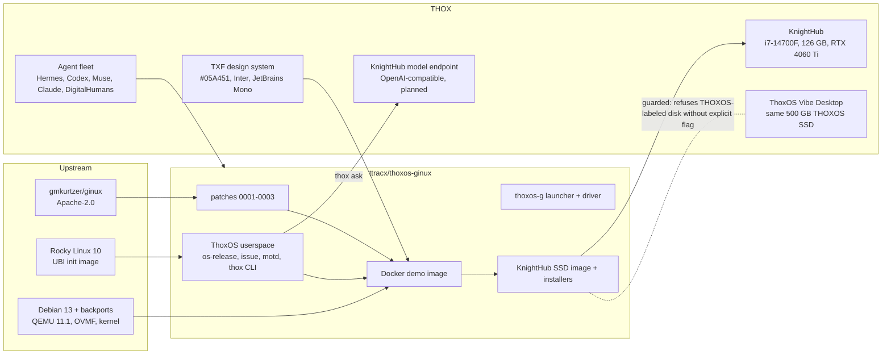

# Ecosystem map: ThoxOS Ginux Edition

## Where it sits

| Field | Value |
|---|---|
| Parent product | ThoxOS (THOX operating system family) |
| Sibling editions | ThoxOS Vibe Desktop (Pop!_OS + COSMIC, KnightHub external SSD), ThoxOS webby edition, ThoxOS iOS and Watch, ThoxOS Android |
| Role | Research and demo edition: ThoxOS identity and tooling on a non-Linux kernel (Ginux), shown in Docker anywhere and on KnightHub hardware |
| Status | 0.1.0 research preview. Not a product kernel |

## Upstream dependencies

| Dependency | Pin | Risk |
|---|---|---|
| Ginux | commit `36503bd` in `upstream.lock` | Research code, no audit, fast-moving; patches must be rebased per bump |
| Rocky 10 UBI init | digest in `upstream.lock` | Stable; userspace changes are file-only |
| QEMU 11.1 (trixie-backports) | Debian package | QEMU 10.0.x breaks Ginux virtio-net (F3) |
| Distribution registry v2, ttyd 1.7.7 | image digest, binary SHA-256 | Low |

## Downstream consumers

| Consumer | Uses |
|---|---|
| Tommy (demos, Kickstarter and social content) | Docker demo, KnightHub boot |
| THOX content library | Review findings and boot captures as post material |
| Fleet lanes | Handoffs in `handoffs/` |

## Data boundaries

| Boundary | Rule |
|---|---|
| Guest to outside | No inbound ports; outbound NAT through QEMU user networking only |
| Guest to host | 10.0.2.2 reaches host loopback: DNS (53), registry (443, read-only), optional model endpoint (11434) |
| Secrets | Registry leaf key only inside the image or host (0600); root key destroyed at build; admin password via BuildKit secret; web credential generated per container |
| User data | Lives in the Ginux volume (`volume.raw`) on the host state directory; no cloud sync |
