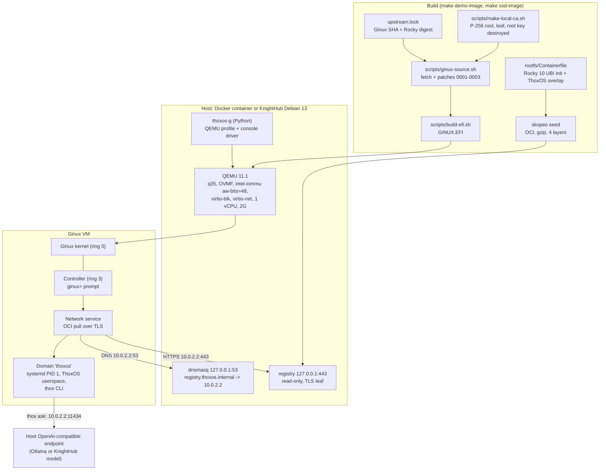
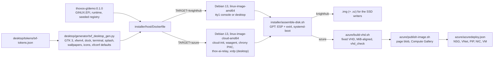

# Development

Developer handoff for ThoxOS Ginux Edition. User-facing docs: [USER_GUIDE.md](USER_GUIDE.md), [QUICKSTART.md](QUICKSTART.md).

## Architecture

0.2.0 adds host targets around the same guest. One Dockerfile (`installer/host/Dockerfile`) builds every host root; `TARGET` picks the kernel and agents, `DESKTOP` adds ThoxOS Desktop:

Three layers in one slice:

| Layer | Component | Files |
|---|---|---|
| AI | `thox ask` sends prompts to any OpenAI-compatible endpoint on the host (`/etc/thoxos/ai.env`); `thox status` reports it. On Azure, `thox-ai-relay` serves that endpoint on loopback and forwards to a hosted model with the key kept on the host (loopback only, 1 MiB request cap, rate limit, no streaming, no body logging). Desktop: Ask THOX launcher, `?` launcher search action, LOCAL/HOSTED/AI OFF chip | `rootfs/overlay/usr/local/bin/thox`, `runtime/thox_ai_relay.py`, `azure/overlay/etc/systemd/system/thox-ai-relay.service`, `desktop/bin/thoxos-ai-chip`, `desktop/bin/thoxos-ask` |
| Backend | Patched Ginux, local PKI, read-only TLS registry, DNS forwarder, QEMU profile and controller driver, host services. Azure: cloud-init datasource and user policy, agent with provisioning handed to cloud-init, Hyper-V initrd, PTP time, VHD conversion and checks, gallery publish, ARM template with a first-boot script that writes the look and relay settings | `patches/`, `scripts/`, `runtime/`, `docker/`, `installer/host/`, `azure/` |
| Frontend | Serial console (Docker `-it`, KnightHub tty1), browser console (ttyd), and ThoxOS Desktop: generated TXF themes, top bar with global menu, dock, Plymouth splash, LightDM and xrdp login, three looks with `thoxos-look` | `docker/entrypoint.sh`, `installer/host/overlay/`, `desktop/` |

## Why it is built this way

- Ginux drives only QEMU's virtio devices, so every ThoxOS target runs Ginux inside QEMU. KnightHub keeps a Debian kernel for its real NVMe, USB, NIC and GPU, and hands Ginux KVM.
- Ginux pulls userspace only over HTTPS on port 443 and trusts two pinned roots. Patch 0003 adds one more root, generated per build and accepted for exactly `registry.thoxos.internal`. Its private key is destroyed after signing the registry leaf, so nothing else can ever be signed under it.
- The registry and DNS bind to host loopback; QEMU user networking maps the guest's 10.0.2.2 to it. Nothing in the guest is reachable from outside (no `hostfwd`).
- `thoxos-g` owns the QEMU command line in one tested function, so the Docker demo and the SSD host cannot drift.

## Setup

| Need | Version used |
|---|---|
| Docker with BuildKit | 29.9 |
| Python | 3.11 or newer (3.13 used) with pytest |
| For `make efi` only | rustup, clang, git, openssl |

## Build and test

| Command | What it does | Time on 2 cores (no KVM) |
|---|---|---|
| `make test` | 70 pytest cases plus `bash -n` and shellcheck when installed | 2 s |
| `make demo-image` | Userspace image, then the four-stage demo image | Cold build not timed in this pass (it compiles Ginux); under 1 min with a warm cache |
| `make selftest` | Boots ThoxOS in Docker until `login:` | 53 s measured (TCG, 2 vCPU build host, includes the 41 s OCI pull) |
| `make ssd-image` | Host root plus 8 GiB GPT disk image in `build/ssd/` | 6 min cold, 1 min with a warm cache |
| `tests/e2e/boot-ssd-image.sh IMG OUT` | Boots the SSD image as a USB disk in QEMU, checks host services, captures tty1 | 2 min 14 s measured on the final image (TCG) |
| `installer/build-host-image.sh --target azure --desktop desktop ...` | Azure desktop host root, disk, fixed VHD in `build/azure/` | 117 s with a warm Docker cache (desktop), 47 s (headless); about 4 min when the desktop packages change |
| `tests/e2e/boot-azure-image.sh VHD OUT GINUX_WAIT` | Boots the VHD in QEMU with a NoCloud seed (cloud-init path of Azure), checks provisioning and services, captures splash, greeter, xrdp login and an RDP session per look | 20 min 43 s for the desktop with `GINUX_WAIT=600`; 15 min 19 s for the headless image, most of it the nested Ginux boot (TCG) |

Behind a TLS-inspecting proxy add `EXTRA_CA=/path/ca.pem`; the CA reaches only the RUN steps that fetch (BuildKit secret).

### make test policy: green does not depend on who runs it

`make test` is expected to exit 0 both as root and as an unprivileged
user. Two findings are settled as repo policy, not as host luck:

- Entrypoint tests are root-required. `tests/test_entrypoint_environment.py`
  runs the real `docker/entrypoint.sh`, which writes
  `/var/log/thoxos-g-registry.log`, runs `usermod`/`groupadd` and `chown`,
  and drops privileges with `setpriv` to the `thoxos` user. The module
  therefore carries a pytest `skipif` on `os.geteuid() != 0` whose reason
  names that privilege requirement. Under root those tests run in full;
  as an unprivileged user they skip with that reason instead of failing.
  No assertion is deleted or weakened by the skip.
- ShellCheck SC2329 is dispositioned in `.shellcheckrc` in this
  directory. SC2329 reports a function as never invoked when it is in
  fact invoked indirectly; see the comment in that file for the
  `run_step` dispatch case in `scripts/local-ci.sh`. ShellCheck still
  runs as part of `make test` and must pass; only SC2329 is disabled.

## Patch workflow

1. `bash scripts/ginux-source.sh build/ginux-src` (pinned commit plus current patches).
2. Edit inside `build/ginux-src`, commit there with a message that explains the upstream reason.
3. `git -C build/ginux-src format-patch -o ../../patches <GINUX_COMMIT>` and renumber.
4. Rebuild and run `make selftest`. A patch that cannot pass the selftest does not ship.

## Continuous integration

CI runs on a developer or build machine, not on GitHub Actions (cost; DECISIONS D32). The checks are the ones the retired Actions workflow ran, and the result still reaches pull requests as a commit status named `thox/local-ci`.

| Command | What it does |
|---|---|
| `make ci` | `make test` with a log and a JSON result in `build/local-ci/<sha>.*` |
| `make ci-report` | The same, then posts the result as a commit status on `HEAD` with `gh`; refuses a dirty tree so the status describes exactly the committed files |
| `make ci FULL=1`, `make ci-report FULL=1` | Adds the full desktop theme generation test in a Debian 13 container with the real fonts and icon theme |
| `scripts/install-pre-push-hook.sh` | Makes `git push` run the gate first when the push changes `ginux-edition/`; a red result stops the push (`--no-verify` skips it, `--remove` uninstalls) |

Flow: install the hook once, push (the gate runs), then `make ci-report` so the pushed commit shows its check on the pull request. Posting needs `gh` signed in with write access to the repository's commit statuses; sandboxed agent runtimes whose proxy blocks that API run `make ci` and leave the posting to a THOX machine. The heavy gates stay manual and are recorded in VALIDATION.md: `make selftest`, `tests/e2e/boot-ssd-image.sh` and `tests/e2e/boot-azure-image.sh`.

## Conventions

- Commit messages: imperative subject, body explains why. `docs:` prefix for documentation-only commits.
- Shell: `set -euo pipefail`, `fail()` helper, no unquoted expansions.
- Python: stdlib only in anything that ships into an image; type hints everywhere.
- Every pinned input (Ginux SHA, image digests, ttyd checksum) lives next to the code that uses it, with a comment saying why.

## Work log

| Date | Change |
|---|---|
| 2026-10-28 | 0.1.0: review, patches 0001-0003, ThoxOS userspace, Docker demo, KnightHub SSD image, installers, tests |
| 2026-10-29 | 0.2.0 host images: Azure target (cloud kernel, cloud-init, agent, VHD, gallery, ARM), ThoxOS Desktop (TXF 5.2, three looks) for Azure and KnightHub, hosted AI relay, per-user Ginux VMs, QEMU and RDP test bench; cold rebuild of GINUX.EFI |

## Known limits

- Ginux limits apply in full (see [REVIEW.md](REVIEW.md)): one vCPU, VM RAM at most 2816 MiB, virtio-only devices, no audit, development signing key.
- The KnightHub path is validated in QEMU with a USB disk and an e1000e NIC, not yet on KnightHub hardware.
- `Install-ThoxOSGinux.ps1` is written to the same guard list as `install-to-ssd.sh` but has not run on Windows.
- Secure Boot is unsupported on the SSD (unsigned systemd-boot).
- The guest hostname is `ginux` (kernel constant).
- The Azure images have not run on Azure. The QEMU bench exercises cloud-init through the NoCloud datasource; the Azure datasource, the agent, Hyper-V devices, PTP time and nested virtualization only run on Azure.
- Ginux has no graphics, so ThoxOS on Ginux is a terminal inside the desktop.
- TXF surfaces not shipped in 0.2.0: redrawn icon set, cursors, GTK 4 and Qt themes, editor theme, lock screen ([DESKTOP.md](DESKTOP.md)).

## Roadmap

See [DEV_QUEUE.md](DEV_QUEUE.md).
